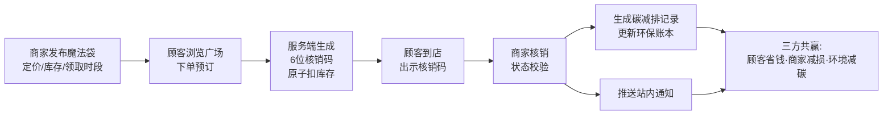

# 🌱 惜食余量魔法袋 · Food Surplus

> **让当日余量食物遇见需要它的人。**
> 商家把当天卖不完、却依然新鲜的食物装进"魔法袋"低价出售；顾客省钱买到美味，商家减少损耗，环境少一份浪费。每次领取自动累积成"环保账本"里的减碳记录。


一个**可直接部署上线**的全栈网页应用。后端 FastAPI + MySQL（Redis 可选降级），前端 Vue 3 + Vite + Element Plus。

---

## ⭐ 项目亮点（30 秒速览）

- **完整业务闭环**：下单 → 核销 → 碳账本 → 站内通知，一次操作贯穿多个模块，不是孤立的 CRUD。
- **工程化到位**：JWT 认证、幂等初始化脚本、配置全走环境变量、`/health` + `/ready` 健康检查、Redis 不可用自动降级、结构化日志 + 请求 ID。
- **质量保障**：16 项接口冒烟测试 + 15 项端到端闭环测试，全部通过。
- **开箱即用**：Windows 一键启动脚本、Docker Compose 一键部署，含前后端分离与 Nginx 反向代理。
- **真实业务约束**：库存原子扣减、订单 15 分钟超时自动释放、核销状态机校验 + 幂等防护。

---

## 🧩 技术栈

| 层 | 技术 |
|---|---|
| 前端 | Vue 3 · Vite · Element Plus · Pinia · Axios |
| 后端 | FastAPI · SQLAlchemy · Pydantic · JWT · Uvicorn |
| 存储 | MySQL 8.0 · Redis（可选，自动降级为内存） |
| 部署 | Docker Compose · Nginx · 多阶段构建 |

---

## 🔄 业务闭环（核心设计）



**关键实现**：魔法袋下单时 `merchant_id` 为空会导致商家看不到订单。解决方案是**从魔法袋所属门店反查管理员**并写入订单——这是本项目修复的核心业务闭环 bug（见 `backend/app/services/order_service.py`）。

---

## 🎬 面试演示动线（照着操作即可）

用**无痕窗口**打开前端，先在 Swagger（`http://127.0.0.1:8000/docs`）演示后端，再切前端演示界面。

| 步骤 | 操作 | 期望结果 / 讲解点 |
|---|---|---|
| 1 | `GET /health`、`GET /ready` | 200，健康检查分层 |
| 2 | `POST /api/v1/auth/login` 填 `admin/admin123` | 200，JWT 含 ID/角色/门店 |
| 3 | 右上角 Authorize 用 **HTTPBearer** 栏粘贴 token | 带锁接口解锁（⚠️ 不要用会报 500 的 OAuth2 弹窗） |
| 4 | `POST /api/v1/orders/create` | **201**，记下响应里的 `id`（数字）和 `verify_code`（6 位码） |
| 5 | `POST /api/v1/merchant/orders/{id}/verify` | 200，`status` 从 1→2；⭐讲核心闭环 bug 的修复 |
| 6 | `GET /api/carbon/platform/summary` | 200，`total_order_count` +1，一次核销贯穿三模块 |

> **演示账号**：顾客 `user / user123`　商家 `admin / admin123`（登录页有一键填入）
>
> **避坑**：下单请求体不要用 Swagger 默认的 `"order_no":"string"`（会撞唯一约束报 500），只传 `bag_id`、`customer_phone`、`customer_name`、`pay_method`；订单 15 分钟未核销会超时，需重新下单再核销。

前端演示：顾客登录 → 魔法袋广场预订拿核销码 → 退出换商家登录 → 门店订单核销 → 回到顾客看环保账本与通知铃铛。

---

## 🚀 快速启动

### 方式 A：本机一键启动（无需 Docker，Windows 推荐）

前置：安装 **Python 3.10+**、**Node.js 18+**，且 **MySQL 已运行**，并把连接信息填入 `backend/.env`（可参考 `backend/.env.example`）。

双击项目根目录的 **`start-local.bat`**。脚本自动完成：清理占用端口的旧进程 → 创建虚拟环境 → 装依赖 → 初始化数据库 → 启动前后端 → 等待就绪 → 自动打开浏览器（前端 + 后端文档两个标签页）。

启动后访问：
- 前端页面：<http://127.0.0.1:5173>
- 接口文档：<http://127.0.0.1:8000/docs>

**停止服务**：双击 **`stop-local.bat`**（按端口精准关闭前后端进程）。

> 启动/停止脚本为纯 ASCII + CRLF 编码，已规避中文在 cmd 中乱码导致的一闪而过问题。

<details>
<summary>手动启动（脚本异常时的备选）</summary>

```bat
cd /d D:\food_surplus\backend
set PYTHONPATH=
.venv\Scripts\python.exe -m uvicorn app.main:app --host 127.0.0.1 --port 8000
```
```bat
cd /d D:\food_surplus\frontend
npm run dev -- --host 127.0.0.1
```
</details>

### 方式 B：Docker 一键部署（推荐上线）

```bash
# 1. 生成配置文件并修改密钥（SECRET_KEY、MYSQL_PASSWORD、CORS_ORIGINS）
cp backend/.env.example .env

# 2. 一键启动全部服务（MySQL + Redis + 后端 + 前端）
docker compose up -d --build
```

访问 `http://服务器IP`（前端 80 端口）、`http://服务器IP:8000/docs`（接口文档）。

---

## ✅ 用户功能

**顾客端**：登录/注册 → 魔法袋广场浏览 → 预订拿 6 位核销码 → 到店自提 → 环保账本看减碳记录 → 站内通知。

**商家端**：登录 → 新建/编辑魔法袋（可传封面图） → 门店订单查看与核销 → 自提门店信息（地址复制/导航）。

---

## 🛠 技术实现与工程化

- **业务闭环**：下单反查门店管理员写入 `merchant_id`，打通商家可见性与核销链路。
- **数据一致性**：订单号/核销码服务端生成；事务内原子扣减库存；15 分钟超时后台任务自动释放库存；核销状态机校验 + 幂等防护。
- **认证安全**：JWT 载荷用用户 ID（避免类型不一致的 500），携带角色与门店 ID；bcrypt 密码哈希。
- **可部署性**：配置全部走环境变量；幂等初始化脚本（建表/补列/种子数据可重复执行）；Redis 不可用自动降级；`/health` `/ready` 健康检查；CORS 显式来源；请求 ID + 结构化日志。
- **增强功能**：图片上传（本地持久化 + 类型白名单 + 5MB 限制）、自提门店导航、支付状态标识、站内通知。

---

## 🧪 测试

```bash
# 后端接口冒烟测试（16 项）
cd backend && .venv\Scripts\python.exe tests\smoke_test.py

# 端到端闭环测试（15 项）：下单→商家可见→核销→碳账本→通知→门店
.venv\Scripts\python.exe tests\e2e_test.py

# 前端构建
cd frontend && npm run build
```

**结果**：冒烟 16 项 + 端到端 15 项全部通过，前端构建通过。

---

## 📁 目录结构

```
food_surplus/
├── start-local.bat / stop-local.bat   # 本机一键启停
├── docker-compose.yml                 # Docker 编排
├── backend/
│   ├── app/
│   │   ├── api/            # 接口路由（含 v1 盲盒体系 + 魔法袋兼容层）
│   │   ├── core/           # 配置、安全、依赖注入
│   │   ├── models/         # SQLAlchemy 数据模型
│   │   ├── schemas/        # Pydantic 校验模型
│   │   ├── services/       # 业务逻辑（order_service.py 含闭环修复）
│   │   └── main.py         # 应用入口、健康检查、日志中间件
│   ├── scripts/init_db.py  # 幂等初始化
│   ├── tests/              # smoke_test.py / e2e_test.py
│   └── .env.example        # 环境变量示例（真实 .env 不入库）
└── frontend/
    └── src/
        ├── api/            # 请求封装
        ├── views/          # 页面（Bags/MyOrders/Carbon/Stores/...）
        ├── layout/         # 顶部导航
        └── styles/         # 环保主题样式
```

---

## 🔒 上线前检查清单

1. 修改 `SECRET_KEY`（随机长字符串）、`MYSQL_PASSWORD`、默认账号密码。
2. `CORS_ORIGINS` 只保留真实前端域名。
3. 确认 `DEBUG=false`。
4. 为 MySQL 与上传卷 `upload_data` 配置定时备份。
5. 多实例部署时启用 Redis 并共享同一 `SECRET_KEY`。
6. 真实在线支付需接入微信/支付宝商户（当前"在线支付"为状态标识演示，不涉及真实资金）。
